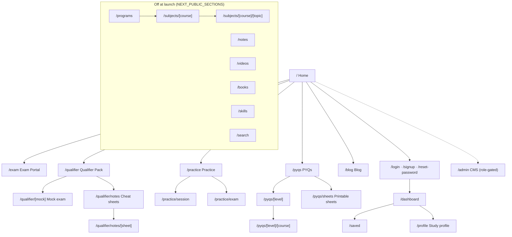
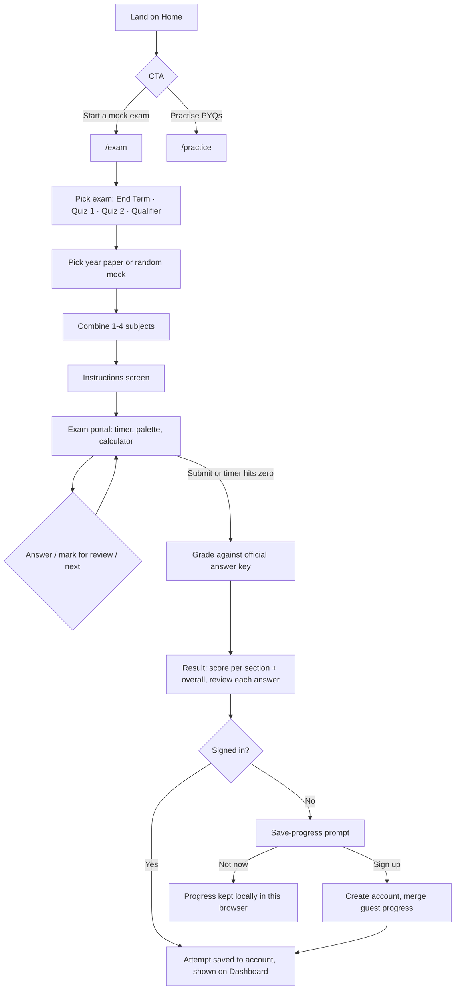
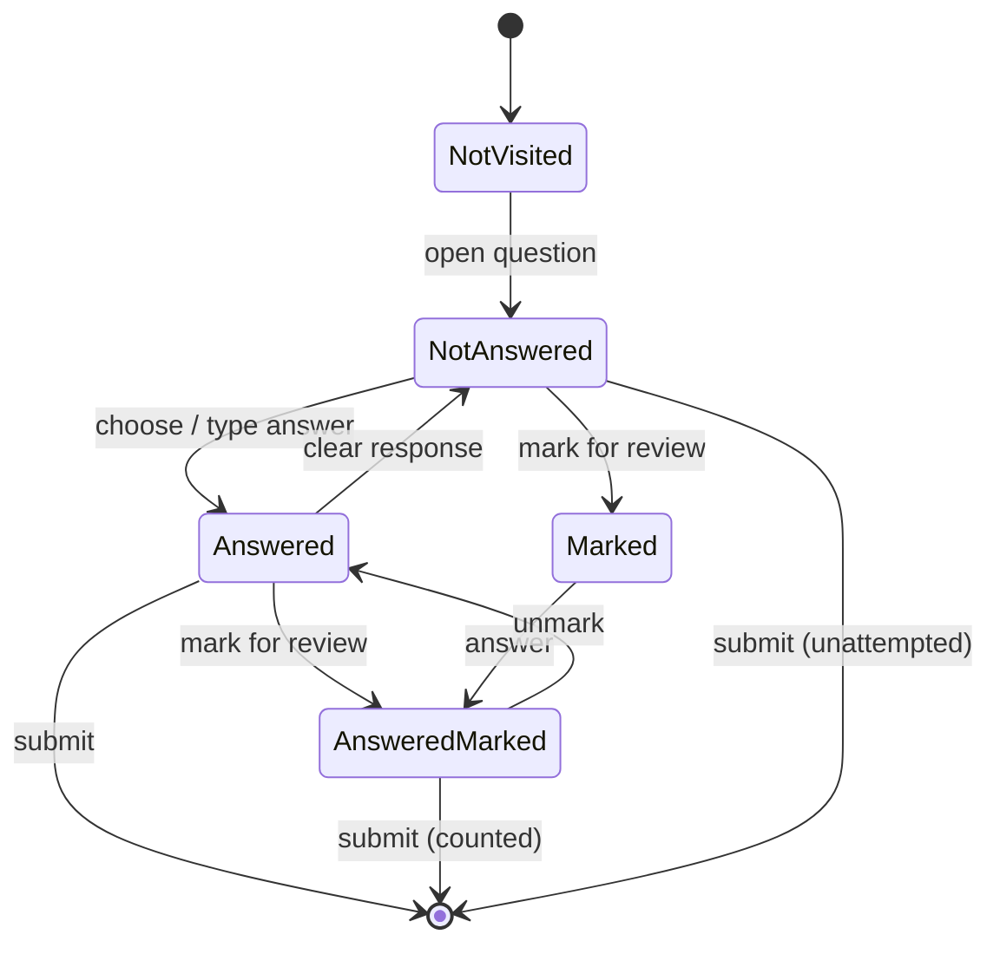
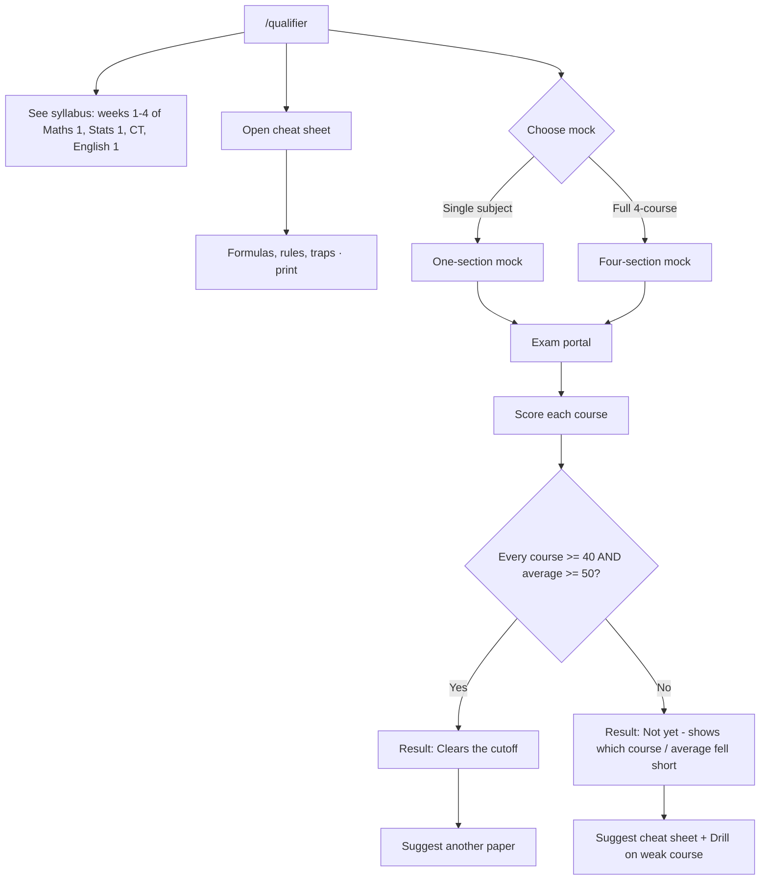
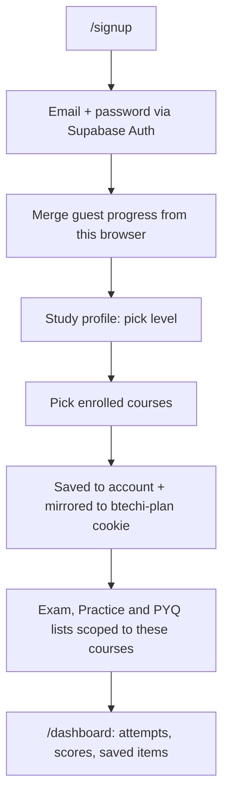
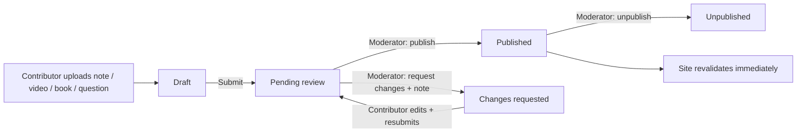
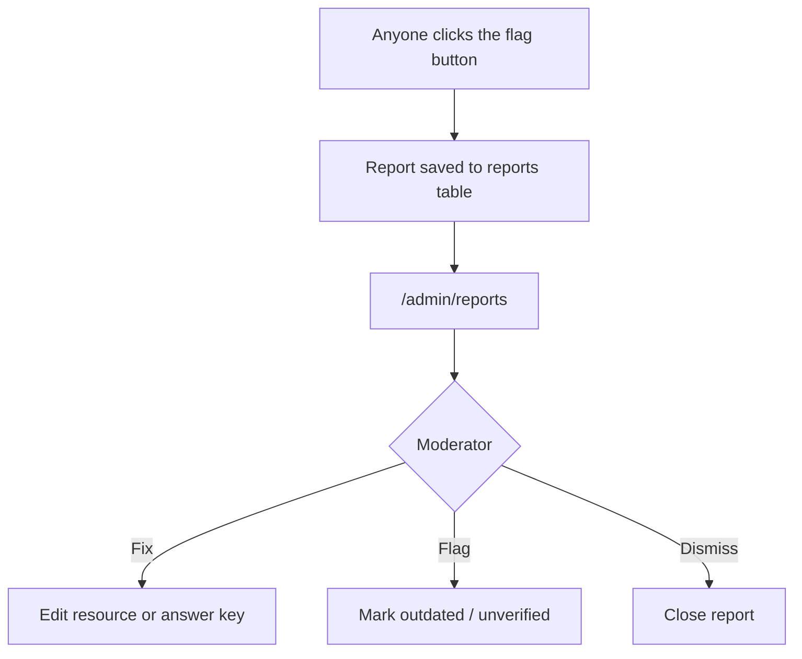
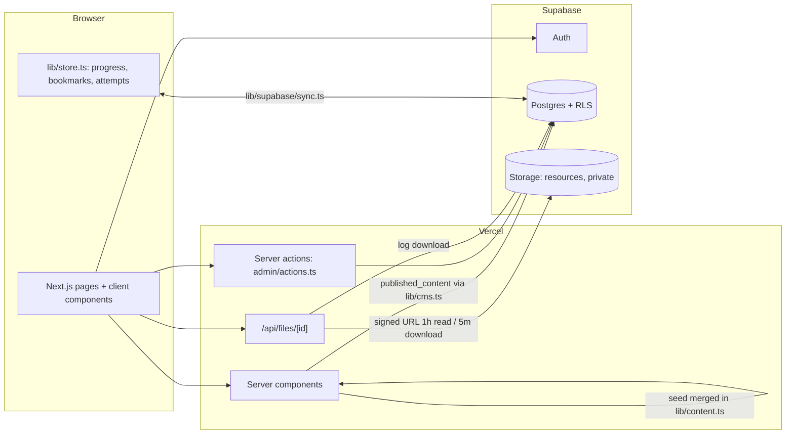

# BTechi: User and System Flows

Diagrams are Mermaid; they render on GitHub and in most Markdown viewers.

---

## 1. Site map (launch build)

## 2. Core journey: sit a mock exam (guest or signed in)

### Exam portal question states

## 3. Qualifier Pack

## 4. Practice

```mermaid
flowchart TD
    A["/practice"] --> B[Filters: course, week, topic, difficulty, question type]
    B --> C{Mode}
    C -->|Quick practice| Q[10 questions]
    C -->|Drill| R[15 questions]
    C -->|Every question| S[All matching questions]
    C -->|Full test| T[A whole paper]
    C -->|Mock exam| U[Timed, exam portal]
    Q & R & S & T --> V["/practice/session"]
    U --> W["/practice/exam"]
    V --> X[Answer, then Why? explanation]
    X --> V
    V --> Y[Summary: score + weak topics]
    W --> Y
    Y --> Z[Practise weak topics again]
    Z --> B
```

Passage-based questions are drawn as one block so a passage is never split.

## 5. Onboarding and study profile

Login: `/login` → `/dashboard`. Forgot password: `/reset-password` → email link → new password → `/login`.

## 6. Content publishing (Admin CMS)

## 7. System flow

- Every read runs under Row Level Security; roles live in `profiles.role`.
- Pages revalidate every 5 minutes, or immediately on publish.
- The `/admin` gate in the browser only decides what to show; the database decides what is allowed.

## 8. Navigation

| Desktop top nav | Resources menu | Account menu |
|---|---|---|
| Practice · Exam Portal · Qualifier Pack (+ Programs, Skills, Search when on) | Cheat sheets · Blog (+ Notes, Videos, Books when on) | Dashboard · Saved · Study profile · Theme toggle |

On mobile the same destinations move to a slide-in drawer and a bottom navigation bar.
